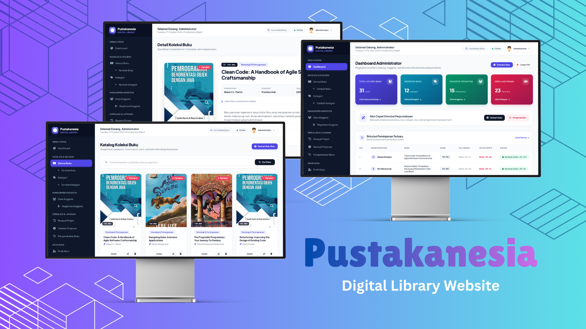

# Pustakanesia - Digital Library

[](https://laravel.com/)
[](#)
[](#)
[](https://tailwindcss.com/)
[](https://getbootstrap.com/)
[](#)
[](./LICENSE)

<p align="center">
  
</p>

Pustakanesia is a full-stack digital library management and book circulation web application engineered to modernize academic and institutional library operations. Built with Laravel 8, Tailwind CSS, and MySQL, the platform transitions manual paper-based book ledgers, unorganized inventory tracking, and physical loan cards into an automated, synchronized digital ecosystem. It streamlines collection management, catalog discovery, member registration, and borrowing workflows into a single unified portal.

The application implements a secure, role-based architecture serving two distinct user personas: **System Administrators** and **Library Members (*Anggota*)**. Administrators manage the complete book catalog inventory with ISBN codes, genres, multi-category associations, and cover uploads; oversee member profiles with Student ID Number (*NPM*) tracking; validate borrowing transactions; process book returns; and export comprehensive PDF circulation reports. Meanwhile, registered members access a dedicated reading room dashboard where they can search the catalog across 12 diverse genres, inspect rich book synopses, submit loan requests under an automated 3-book limit constraint, and track due dates in real time.

---

## Features

- **Multi-Role Authentication & Access Control**: Secure session-based authentication separating system administrative functions from member self-service portals, backed by Bcrypt password hashing.
- **Dynamic Dual Dashboard Experience**:
  - **Administrator Dashboard**: Comprehensive command center displaying real-time KPI metrics (total book collection count, category count, registered member count, and circulation loan records), quick-action circulation shortcuts, and an instant overview of recent borrowings.
  - **Member Reading Room**: Personalized patron dashboard showing available catalog totals, genre breakdowns, member community statistics, active personal loan counters, and an institutional lending policy guide.
- **Comprehensive Book Catalog & Multi-Category Architecture**:
  - Full CRUD inventory management tracking book title, unique code (`kode_buku`), author, publisher, publication year, detailed synopsis, and cover image uploads with automatic fallback handlers.
  - Many-to-many relationship mapping (`kategori_buku`) powered by Select2 interactive tags, allowing books to be linked to multiple genres simultaneously.
  - Live catalog search by title and author with responsive 8-item pagination.
- **Interactive Category Management**: Dedicated classification module enabling administrators to create, edit, inspect, and remove book categories and academic genres.
- **Member Directory & Profile Governance**: Administrative registry managing student member records, including Student ID Numbers (*NPM*), study programs (*Prodi*), physical addresses, phone numbers, and profile photo avatar management.
- **Automated Circulation & Borrowing Engine**:
  - Loan creation that automatically timestamps the borrow date (`tanggal_pinjam`) and computes a strict 7-day return deadline (`tanggal_wajib_kembali`).
  - Automated loan quota enforcement that restricts each member to a maximum of 3 active unreturned books simultaneously.
  - Atomic database transactions (`DB::beginTransaction()` and `DB::commit()`) ensuring consistency between circulation history records and real-time book availability statuses (`In Stock` vs. `dipinjam`).
- **Streamlined Book Return & Inventory Reconciliation**: Dedicated return interface allowing administrators to select active borrowers, record return dates, and automatically restore book availability back to stock.
- **Automated PDF Circulation Reporting**: Integrated DomPDF engine generating downloadable, printable summary reports (`laporan_peminjaman.pdf`) containing detailed audit records, borrower identities, book metadata, transaction dates, and return statuses.
- **Modern User Interface & Interactive Feedback**: Built with Tailwind CSS and the Plus Jakarta Sans typeface, enhanced with Font Awesome 6 icons, Select2 interactive dropdowns, and SweetAlert toast notifications for user interactions.

---

## Preview & Demo

The application's member reading room, catalog search, administrator dashboards, and circulation workflows are illustrated below:

### Member Experience & Catalog Navigation


*Member Reading Room & Patron Exploration: Patron Dashboard (top-left) featuring quick catalog counters, active borrowing telemetry, and library lending policy rules; Book Collection Catalog (top-right) with live search, book covers, availability status tags (`In Stock` / `Dipinjam`), and category badges; Book Detail Specification (bottom-left) displaying high-resolution cover artwork, unique book code, publication metadata, synopsis, and direct loan action; and Personal Loan History Tracker (bottom-right) auditing active vs. returned books with due date monitoring.*

### Administrator Command Center & Circulation Governance


*Administrative Control Center: Administrator Dashboard (top-left) providing real-time catalog analytics, circulation quick actions, PDF report export shortcuts, and recent transaction audit tables; Category Management Directory (top-right) listing genres and topic descriptions; Member Directory Management (bottom-left) tracking student members, NPM identifiers, study programs, and account credentials; and Book Inventory Form (bottom-right) featuring Select2 multi-category tagging, metadata fields, and cover image upload controls.*

---

## Tech Stack

### Core Architecture & Backend
- **PHP**: `^7.3 | ^8.0` &mdash; Core server-side scripting language
- **Laravel Framework**: `8.75` &mdash; Modern PHP web framework utilizing the MVC pattern, Eloquent ORM, and Blade templating
- **MySQL / MariaDB**: Relational database engine with foreign key cascades and relational constraints
- **Laravel Sanctum**: `^2.11` &mdash; API token and cookie-based authentication scaffolding
- **Laravel UI**: `^3.4` &mdash; Authentication scaffolding

### Frontend & User Interface
- **Tailwind CSS**: `3.x` &mdash; Utility-first CSS framework configured with a custom brand indigo palette
- **Bootstrap**: `5.1.3` &mdash; Component framework used for grid alignments and modal layouts
- **Plus Jakarta Sans**: Modern geometric typeface from Google Fonts
- **Font Awesome**: `6.5.1` &mdash; Vector iconography across navigation, actions, and status indicators

### Client-Side Libraries & Plugins
- **jQuery**: `3.6.4` &mdash; Client-side script handling and DOM event manipulation
- **Select2**: `4.0.13` &mdash; Multi-select search dropdown for relational book category tags
- **SweetAlert (RealRashid)**: `^5.1` &mdash; Interactive toast alerts, confirmation dialogues, and action notifications

### Document Generation & Build Tooling
- **Laravel DomPDF (Barryvdh)**: `^2.0` &mdash; Server-side PDF rendering engine for circulation reports
- **Laravel Mix**: `^6.0.6` &mdash; Webpack-based asset compilation pipeline
- **Sass / PostCSS**: Modern CSS preprocessing and autoprefixing

### Testing & Development
- **PHPUnit**: `^9.5.10` &mdash; Automated unit and feature testing framework
- **Mockery**: `^1.4.4` &mdash; Mock object framework for testing
- **FakerPHP**: `^1.9.1` &mdash; Realistic seed data generation

---

## Prerequisites

Ensure your local development environment meets the following minimum requirements:

- **PHP**: `>= 7.3` or `>= 8.0` (with `bcmath`, `ctype`, `fileinfo`, `json`, `mbstring`, `openssl`, `pdo_mysql`, `tokenizer`, `xml`, and `gd` extensions enabled)
- **Composer**: `>= 2.0`
- **Node.js**: `>= 14.x` & **npm**: `>= 6.x`
- **MySQL / MariaDB**: `>= 5.7` or `>= 8.0`
- **Web Browser**: Google Chrome, Mozilla Firefox, Microsoft Edge, or Safari

---

## Installation & Setup

Follow these verified steps to set up and run Pustakanesia locally:

### 1. Clone the Repository
```bash
git clone https://github.com/weztcy/Pustakanesia---Digital-Library.git
cd Pustakanesia---Digital-Library
```

### 2. Install PHP Dependencies
```bash
composer install
```

### 3. Install Node.js Dependencies
```bash
npm install
```

### 4. Configure Environment Variables
Copy the example environment configuration file:
```bash
cp .env.example .env
```
*(On Windows PowerShell, use `copy .env.example .env`)*

### 5. Generate Application Encryption Key
```bash
php artisan key:generate
```

### 6. Configure Database Credentials
Create a dedicated MySQL database (e.g., `pustakanesia`), then edit your `.env` file with your database connection parameters:
```env
DB_CONNECTION=mysql
DB_HOST=127.0.0.1
DB_PORT=3306
DB_DATABASE=pustakanesia
DB_USERNAME=root
DB_PASSWORD=
```

### 7. Run Database Migrations & Seeders
Execute the database migrations and seed the comprehensive realistic library dataset (including categories, users, profiles, books, and borrowing records):
```bash
php artisan migrate:fresh --seed
```

### 8. Compile Frontend Assets
Compile stylesheets and JavaScript assets:
```bash
npm run dev
```

### 9. Create Storage Symlink
Ensure uploaded book covers and member avatars are accessible through the web server:
```bash
php artisan storage:link
```

---

## Environment Variables

The table below outlines the primary configuration variables defined in `.env.example`:

| Variable | Description | Safe Illustrative Value | Required |
| :--- | :--- | :--- | :--- |
| `APP_NAME` | Name of the web application | `Pustakanesia` | Yes |
| `APP_ENV` | Current runtime environment mode | `local` | Yes |
| `APP_KEY` | 32-character AES application encryption key | *(Generated via artisan)* | Yes |
| `APP_DEBUG` | Toggle detailed error screens and stack traces | `true` | Yes |
| `APP_URL` | Base canonical URL of the application | `http://localhost:8000` | Yes |
| `DB_CONNECTION` | Relational database driver | `mysql` | Yes |
| `DB_HOST` | Database server hostname or IP | `127.0.0.1` | Yes |
| `DB_PORT` | Database server communication port | `3306` | Yes |
| `DB_DATABASE` | Name of the application database | `pustakanesia` | Yes |
| `DB_USERNAME` | Database user account name | `root` | Yes |
| `DB_PASSWORD` | Database user password | `secret_password` | Optional |
| `SESSION_DRIVER` | Session storage driver | `file` | Yes |
| `CACHE_DRIVER` | Application caching mechanism | `file` | Yes |
| `QUEUE_CONNECTION` | Job queue processing driver | `sync` | Yes |

---

## Usage / Running the Project

### Starting the Development Server

1. Open your terminal in the project root directory and start the Laravel local development server:
   ```bash
   php artisan serve
   ```
2. In a separate terminal tab, compile and watch assets for real-time frontend updates:
   ```bash
   npm run watch
   ```
3. Open your web browser and navigate to:
   ```text
   http://127.0.0.1:8000
   ```

---

### Default Seeded Credentials

The database seeder automatically populates the system with pre-configured accounts for testing:

#### 1. Administrator Portal
- **Email**: `admin@admin.com`
- **Password**: `admin123`
- **Role Identifier**: `isAdmin = 1`
- **Responsibilities**: Catalog management, category administration, member registration, circulation management, return approvals, and PDF report downloads.

#### 2. Member Portal (*Anggota*)
- **Email**: `dimas@gmail.com`
- **Password**: `12345678`
- **Role Identifier**: `isAdmin = 0` (NPM: `A11202150273`)
- **Responsibilities**: Catalog exploration, book search, loan requests (up to 3 books), and personal borrowing history tracking.
- *Alternative Seed Members*:
  - `siti.rahma@gmail.com` / `12345678` (NPM: `B22202210105`)
  - `budi.santoso@gmail.com` / `12345678` (NPM: `C33202040019`)
  - `aisyah.kusuma@gmail.com` / `12345678` (NPM: `D44202130122`)

---

## Available Scripts / Commands

The project includes pre-configured commands via Composer, Laravel Artisan, and npm:

| Command | Tool | Purpose |
| :--- | :--- | :--- |
| `php artisan serve` | Artisan | Starts the local HTTP development server on `http://127.0.0.1:8000` |
| `php artisan migrate` | Artisan | Executes pending database migrations |
| `php artisan migrate:fresh --seed` | Artisan | Rebuilds the database schema and executes seeders with sample data |
| `php artisan db:seed` | Artisan | Seeds the database with default library data |
| `php artisan key:generate` | Artisan | Generates a 32-character AES key and writes it to `.env` |
| `php artisan route:list` | Artisan | Displays all registered HTTP routes, controllers, and middleware |
| `php artisan test` | Artisan | Executes automated feature and unit tests via PHPUnit |
| `npm run dev` | npm | Compiles stylesheets and JavaScript assets for development |
| `npm run watch` | npm | Continuously compiles assets upon detecting file modifications |
| `npm run prod` | npm | Compiles and optimizes minified production-ready assets |

---

## API Reference / Documentation

The application defines structured HTTP routes and controller actions across the system:

### Authentication & Core Navigation
- `GET /` &mdash; Displays login view or redirects authenticated users
- `POST /login` &mdash; Authenticates user credentials (`email`, `password`)
- `POST /logout` &mdash; Terminates user session and revokes authentication
- `GET /home` &mdash; Routes to `AdminDashboard` (`isAdmin=1`) or `AnggotaDashboard` (`isAdmin=0`)

### Book Inventory Management (`/buku`)
- `GET /buku` &mdash; Paginated book catalog with title search filter (`?search=keyword`)
- `GET /buku/create` &mdash; Renders book creation form with dynamic category selection
- `POST /buku` &mdash; Stores new book record (`judul`, `kode_buku`, `pengarang`, `penerbit`, `tahun_terbit`, `deskripsi`, `gambar`, `kategori_buku[]`)
- `GET /buku/{id}` &mdash; Displays book detail specifications and synopsis
- `GET /buku/{id}/edit` &mdash; Renders book editing form
- `PUT /buku/{id}` &mdash; Updates book metadata and synchronizes many-to-many category relations
- `DELETE /buku/{id}` &mdash; Removes book record from inventory

### Category Management (`/kategori`)
- `GET /kategori` &mdash; Displays list of all book categories
- `POST /kategori` &mdash; Creates a new category (`nama`, `deskripsi`)
- `GET /kategori/{id}` &mdash; Displays category details and associated books
- `PUT /kategori/{id}` &mdash; Updates category name and description
- `DELETE /kategori/{id}` &mdash; Deletes a category record

### Member Management (`/anggota`)
- `GET /anggota` &mdash; Displays list of registered student members
- `GET /anggota/create` &mdash; Renders student member registration form
- `POST /anggota` &mdash; Registers new student account (`name`, `npm`, `prodi`, `alamat`, `noTelp`, `email`, `password`)
- `GET /anggota/{id}` &mdash; Displays member profile and loan transaction history
- `PUT /anggota/{id}` &mdash; Updates member information
- `DELETE /anggota/{id}` &mdash; Deletes member account and associated profile

### Circulation & Borrowing (`/peminjaman` & `/pengembalian`)
- `GET /peminjaman` &mdash; Lists circulation logs (all transactions for Admin; personal records for Member)
- `GET /peminjaman/create` &mdash; Renders book borrowing transaction form
- `POST /peminjaman` &mdash; Submits new loan (`users_id`, `buku_id`); verifies 3-book limit constraint, sets 7-day due date, and marks book status as `dipinjam`
- `GET /pengembalian` &mdash; Displays active borrowed book return processing view
- `POST /pengembalian` &mdash; Processes book return (`users_id`, `buku_id`); records return timestamp and restores book status to `In Stock`
- `GET /cetaklaporan` &mdash; Generates and downloads `laporan_peminjaman.pdf` containing full circulation history

---

## Testing

The project uses PHPUnit for automated application testing. Tests verify endpoint accessibility and core assertions:

### Executing Tests
Run the test suite using Artisan:
```bash
php artisan test
```
Or directly through the PHPUnit binary:
```bash
./vendor/bin/phpunit
```

### Test Scope
- **Feature Tests** (`tests/Feature/ExampleTest.php`): Verifies HTTP GET `/` returns a valid `200 OK` status.
- **Unit Tests** (`tests/Unit/ExampleTest.php`): Evaluates foundational unit assertions.

---

## Build & Deployment

To deploy Pustakanesia to a production web server (such as an Apache or NGINX virtual host):

### 1. Production Dependency Installation
Install production PHP dependencies without development packages:
```bash
composer install --optimize-autoloader --no-dev
```

### 2. Frontend Asset Production Build
Compile and minify CSS and JavaScript assets:
```bash
npm run prod
```

### 3. Application Optimization & Caching
Cache Laravel configuration, routes, and compiled views:
```bash
php artisan config:cache
php artisan route:cache
php artisan view:cache
```

### 4. Database Migration
Run production migrations:
```bash
php artisan migrate --force
```

### 5. Web Server Configuration
Point your web server's document root strictly to the `public/` directory (not the project root). Ensure proper read/write permissions for the storage and bootstrap cache directories:
```bash
chmod -R 775 storage bootstrap/cache
```

---

## License

Please see the [LICENSE](./LICENSE) file for the terms and conditions governing the use, modification, and distribution of this project.

## Author & Contact

**Yohanes Dimas Pratama**

- GitHub: [github.com/weztcy](https://github.com/weztcy)
- Portfolio: [dimaspratama.vercel.app](https://dimaspratama.vercel.app)
- LinkedIn: [linkedin.com/in/yohanes-dimas](https://www.linkedin.com/in/yohanes-dimas)

